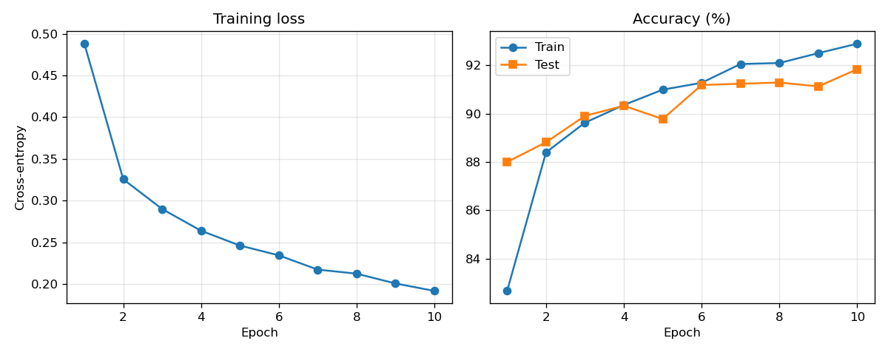
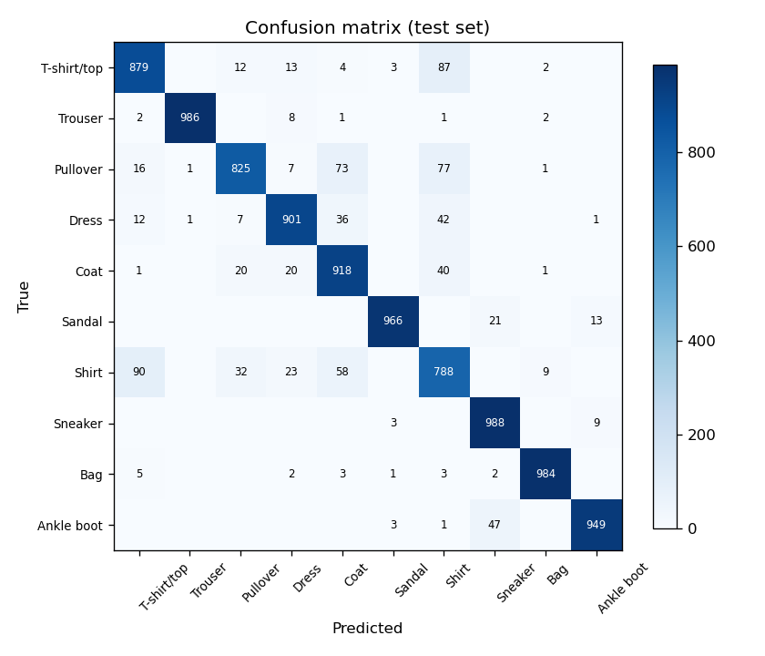
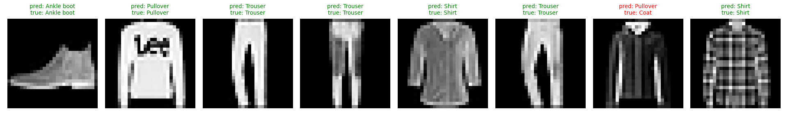

# Fashion-MNIST CNN Classifier

A small convolutional neural network, built with PyTorch, that classifies
[Fashion-MNIST](https://github.com/zalandoresearch/fashion-mnist) images into
10 clothing categories (T-shirt/top, Trouser, Pullover, Dress, Coat, Sandal,
Shirt, Sneaker, Bag, Ankle boot). Trained from scratch on CPU — no GPU, no
pretrained weights.

## Architecture

Defined in `model.py` (~422k parameters):

| Stage | Operation | Output shape |
| --- | --- | --- |
| Input | — | 1 × 28 × 28 |
| Conv block 1 | Conv2d(1→32, 3×3) + BatchNorm + ReLU + MaxPool | 32 × 14 × 14 |
| Conv block 2 | Conv2d(32→64, 3×3) + BatchNorm + ReLU + MaxPool | 64 × 7 × 7 |
| Classifier | Flatten → Linear(3136→128) + ReLU + Dropout(0.3) → Linear(128→10) | 10 |

Training (`train.py`): Adam (lr 1e-3), cross-entropy loss, batch size 128,
random horizontal-flip augmentation, fixed seed 42. The checkpoint with the
best test accuracy is kept.

## How to run

```bash
pip install -r requirements.txt

python train.py            # trains 10 epochs, saves runs/best_model.pt + plots
python train.py --epochs 15 --lr 5e-4   # options: --epochs / --batch-size / --lr / --seed

python predict.py          # classify the first 8 test images with the checkpoint
```

The dataset (~30 MB) is downloaded automatically into `data/` on first use.
Checkpoints and metrics go to `runs/`; both folders are git-ignored.

## Results

Measured on the full 10,000-image test set, from an actual training run on a
2-core CPU (PyTorch 2.14.1+cpu), seed 42:

- **Test accuracy: 91.84%** (best epoch: 10 of 10)
- Training accuracy (epoch 10): 92.90%
- Training time: **695 s (~11.6 min) for 10 epochs**

| Class | Accuracy |
| --- | ---: |
| T-shirt/top | 87.9% |
| Trouser | 98.6% |
| Pullover | 82.5% |
| Dress | 90.1% |
| Coat | 91.8% |
| Sandal | 96.6% |
| Shirt | 78.8% |
| Sneaker | 98.8% |
| Bag | 98.4% |
| Ankle boot | 94.9% |

The weakest class is **Shirt** (78.8%) — most of its errors are confusions with
T-shirt/top, Pullover and Coat, the visually closest categories (see the
confusion matrix below). Trouser, Sneaker and Bag are nearly perfect.

### Training curves



### Confusion matrix



### Sample predictions

`python predict.py` prints true vs predicted labels (7/8 correct on the first
8 test images in this run) and saves this grid — green = correct, red = wrong:



## Files

- `model.py` — the CNN definition and class names
- `train.py` — training loop, evaluation, per-class metrics, plots
- `predict.py` — loads `runs/best_model.pt` and classifies sample test images
- `requirements.txt` — torch, torchvision, matplotlib
